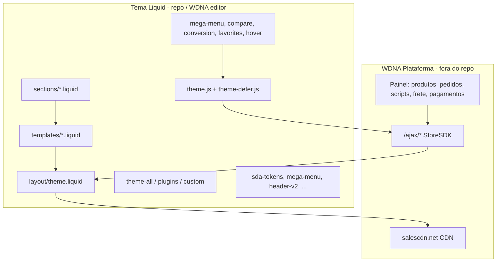

# Arquitetura atual — Site do Ar (WDNA + SDA)

**Data:** 28 out 2026 (America/Sao_Paulo)  
**Confiança:** estrutura de camadas **alta** (código); comportamento runtime em produção **média** (amostra HTTP).

---

## 1. Visão em camadas



---

## 2. Fluxo de renderização por tipo de página

### 2.1 Home (`templates/home.liquid`)

1. Render `sections/header` (menu WDNA + classes SDA `header-v2`).
2. Loop `showcase.sections` → `sections/showcase-model-{typeId}` (modelos 1–14, vídeo 10, etc.).
3. Footer + sidenavs já globais no layout.

**Dono de card quando typeId usa produto:** `showcase-model-product.liquid` → classes `.sda-product-card` + CSS SDA.

### 2.2 Produto (`templates/product.liquid`)

1. Header.
2. `product-content.liquid` (PDP — shell `#product-pdp-v2` quando SDA ativo).
3. Sidenavs frete/pagamento.
4. Footer.

### 2.3 Busca (`templates/search.liquid`)

Filtros `search-filter.liquid`, ordenação `search-order.liquid`, grid lista — JS de conversão SDA enriquece contagem/chips (quando script publicado).

### 2.4 Checkout (`templates/checkout*.liquid`)

Sections `checkout-*` + `header-checkout.liquid` — **core WDNA**; SDA toca pouco (estilos header parcial).

---

## 3. Contratos de dados (Liquid → UI)

| Objeto / variável | Uso típico | Camada |
|-------------------|------------|--------|
| `store`, `theme`, `themeConfig` | Logo, cores painel, telefone | WDNA |
| `menu` | Nav principal | WDNA |
| `cart` | Quantidade, sidenav carrinho | WDNA + Alpine |
| `product`, `relatedProducts` | PDP, preços, mídias | WDNA |
| `showcase.sections` | Home vitrines | WDNA |
| `scripts.header`, `scripts.content` | Pixels, tags admin | WDNA painel |
| `csrfToken` | Forms / AJAX | WDNA |
| `seo` | Meta | WDNA |

**Regra de negócio comercial:** preço Pix, parcelas, estoque e frete são **renderizados pelo Liquid/JS WDNA**; SDA formata e converte, não recalcula regras fiscais/comerciais (confiança **alta**, por design documentado).

---

## 4. Contratos JavaScript

| Global / módulo | Responsabilidade | Dependências |
|-----------------|------------------|--------------|
| `setupStore()` | Login header, estado cliente | Alpine, `StoreSDK` |
| `setupProduct()` | PDP compra, variações | Alpine, `theme.js` |
| `handleAddToCart(...)` | Carrinho | `StoreSDK` |
| `initMegaMenuAr()` | Mega menu DOM | `mega-menu-ar.liquid` template |
| `product-compare.js` | Seleção até 3, painel | `textarea.product-compare-json` |
| `favorites.js` | Lista local | `localStorage`, sidenav |
| `sda-conversion-redesign.js` | Busca, filtros, sticky PDP, carrosséis | DOM vitrine/PDP |

**Ordem de carregamento (Git v3):** `theme.js` (sync) → body content → `theme-defer.js` → SDA `defer` → inline nav fallback → `scripts.main` (WDNA).

---

## 5. Mapa de “donos” SDA (estado alvo no Git — v3 REWRITE)

| Domínio | CSS dono | JS dono | Markup principal |
|---------|----------|---------|------------------|
| Tokens | `sda-tokens.css` | — | — |
| Header bar | `header-v2.css` | `theme.js` | `header.liquid` |
| Nav + mega + dock | `mega-menu.css` | `mega-menu.js` | `mega-menu-ar.liquid` + nav WDNA |
| Card vitrine | `sda-card.css` | `theme.js` (cart) | `showcase-model-product.liquid` |
| Comparador | `product-compare.css` | `product-compare.js` | `product-compare-*` |
| Favoritos | `favorites.css` | `favorites.js` | card + `sidenav-overlay-favorites` |
| Hover 2ª img | `product-hover-image.css` | `product-hover-image.js` | cards |
| Conversão transversal | `sda-conversion-redesign.css` | `sda-conversion-redesign.js` | busca/home/PDP |
| PDP layout | `product-page-v2.css` | mixed | `product-content.liquid` + sections PDP |

**Produção (28/out):** card visual ainda atribuído a `showcase-product-card.css` (geração anterior v4).

---

## 6. Assets core WDNA (preservar)

| Arquivo | Função | Substituir? |
|---------|--------|-------------|
| `theme.js` | Alpine, carrinho, login, vitrine tns | **Evitar** sem diff WDNA |
| `theme-defer.js` | Máscaras, lazy helpers | Idem |
| `theme-plugins.css` | Reset/normalize base | Manter do tema novo |
| `theme-all.css` | Componentes loja | Repo ~322 KB corrigido |
| `theme-custom.css` | Overrides loja | Substituir com cuidado |
| `theme-solar-calculator.*` | Página calculadora | Manter |

---

## 7. Sections SDA criadas (não no export base jul/2026)

Lista em `docs/wdna/pacote-sda/MANIFEST.txt`: mega menu, compare, favoritos, blocos PDP (`product-descriptions-v2`, `sda-pdp-trust`, …), etc.

**Confiança:** alta (manifest + arquivos presentes).

---

## 8. Integrações (implementação localizada vs painel)

| Integração | Onde no código | Confirmado funcionando? |
|------------|----------------|-------------------------|
| Facebook Pixel (`fbq`) | `product-content.liquid`, `search.liquid` | **Não** (depende injeção painel) |
| GA4 (`gtag` view_item) | `product-content.liquid` | **Não** |
| Scripts marketing | `` | Conteúdo **desconhecido** |
| Diagnóstico 360 | `page.diagnostico.liquid`, popup `theme.liquid` | Parcial (página + popup) |
| Afiliado seller/ref | `theme.liquid` captureUrlParameter | Código presente |
| Reviews | Section `product-reviews` no export base | **Não verificado** no repo atual |

---

## 9. Ambientes e deploy

| Ambiente | Mecanismo | Rollback |
|----------|-----------|----------|
| Produção | Editor WDNA + publish tema | Duplicar tema / reverter arquivos |
| Git | Branches (`cursor/*-b192`), PRs | Revert commit |
| Pacote | `docs/wdna/pacote-sda/tema-sda-ultimo.zip` | Substituir arquivos no tema clone |

**Não existe** pipeline CI que publique automaticamente na WDNA (confiança **alta**).

---

## 10. Arquitetura futura recomendada (proposta — aguarda aprovação)

Sem trocar de plataforma:

1. **Manter WDNA core** (`theme.js`, checkout, templates checkout).
2. **Camada SDA modular** já iniciada: tokens + um CSS/JS por domínio.
3. **Extrair** popup D360 e fallbacks nav de `theme.liquid` → assets versionados (reduz HTML inline).
4. **Design system** documentado em `sda-tokens.css` mapeado para aliases `--color-*` pedidos na missão.
5. **Pacote único** alinhado ao MANIFEST v3 (`sda-card`, não `showcase-product-card`).
6. **Smoke checklist** obrigatório pré-activate (ver `PLANO_DE_MIGRACAO.md`).
7. **Testes:** Playwright contra tema preview (fora escopo WDNA repo) — opcional fase 2.

**Benefício:** manutenção previsível, menos “último CSS vence”.  
**Custo:** disciplina de publish completo + tema preview.  
**Risco mitigado:** não reescrever checkout.

---

## 11. Diagrama de dependência CSS (Git v3 — ordem = cascata)

```
theme-plugins → theme-all → theme-custom
  → sda-tokens → mega-menu → header-v2 → favorites → product-compare
  → product-hover-image → sda-conversion-redesign → product-page-v2 → sda-card
```

Qualquer folha fora desta ordem ou CSS inline no layout **quebra** o contrato v3.
