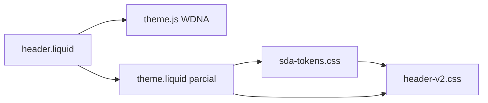

# Plano exclusivo — Etapa 1: Header (busca + nav desktop/mobile)

**Data:** 28 out 2026 (America/Sao_Paulo)  
**Status:** Preparação — **sem upload, sem implementação, sem alteração do tema ativo/produção.**  
**Aprovação anterior:** migração incremental, um componente por vez; **não** autorizado pacote v3 completo.

**Bloqueio explícito até:** (1) URL/nome/ID do **tema preview duplicado** informado pelo responsável; (2) export WDNA de `product-reviews.liquid` arquivado (não usado nesta etapa); (3) aprovação **separada** deste plano para implementação.

---

## 1. Escopo da etapa Header (o que entra / o que fica de fora)

### 1.1 Dentro do escopo funcional

| Área | Comportamento |
|------|----------------|
| Faixa topo (banner WDNA) | Cores/imagem do painel |
| Utility bar (Diagnóstico, Ambiente, etc.) | Links + estilo |
| Logo, H1 home | SEO header |
| Busca desktop (`#myForm2`, `alterForm2`) | Redireciona `/busca/{termo}` |
| Busca mobile (`openSearch`, `#myForm`, `alterForm`) | Overlay WDNA |
| Conta, telefone, WhatsApp, carrinho | Alpine + `theme.js` |
| Menu WDNA (`.nav-content`, `.nav-main`) | Itens do painel |
| Mega menu “Modelos” | Template + JS |
| Nav azul, fixa ao scroll, strip mobile 3 cats | CSS + JS + fallback layout |
| Dock mobile inferior | CSS + JS |
| Menu hamburger mobile (`openNavMobile`) | WDNA |

### 1.2 Fora do escopo (proibido nesta etapa)

| Área | Motivo |
|------|--------|
| Product Card (`showcase-model-product`, `sda-card.css`, `showcase-product-card.css`) | Etapa 2 |
| Product Content / PDP shell | Etapa posterior |
| Checkout (`checkout-*`, `header-checkout` salvo regressão visual mínima) | Crítico WDNA |
| `theme.js`, `theme-defer.js`, `theme-plugins.css` | Core WDNA |
| `theme-all.css`, `theme-custom.css` (salvo ajuste pontual **pré-aprovado**) | Alto blast radius |
| Avaliações (`product-reviews`, API review) | Auditar/recuperar arquivo; **não alterar** |
| Favoritos/comparador (CSS/JS) | Fora header; já carregam globalmente — **não substituir** nesta etapa |

---

## 2. Mapa de arquivos (revisão do plano busca/navegação)

Referência de ownership: `docs/wdna/HEADER-OWNERSHIP.md`.

### 2.1 Arquivos **primários** (donos do Header/nav)

| # | Arquivo | Papel |
|---|---------|--------|
| H1 | `sections/header.liquid` | Markup: `header-v2`, utility, busca, nav, `alterForm`/`alterForm2` |
| H2 | `assets/header-v2.css` | Barra superior, busca pill, utility, badge carrinho laranja, chips mobile |
| H3 | `assets/mega-menu.css` | Nav azul, mega painel, dock, nav fixa, strip mobile |
| H4 | `assets/mega-menu.js` | `initMegaMenuAr`, dock, hover flag, detecção catálogo |
| H5 | `sections/mega-menu-ar.liquid` | Template `#mega-menu-ar-template` |
| H6 | `assets/sda-tokens.css` | Tokens azul/laranja/lilás (`--sda-nav-*`, `--sda-orange`, etc.) — **dependência de estilo** para H2/H3 no Git |

### 2.2 Arquivos **de acoplamento** (mínimo necessário no layout)

| # | Arquivo | Trecho relevante | Nota incremental |
|---|---------|------------------|------------------|
| L1 | `layout/theme.liquid` | `<link>` ordem: tokens → mega-menu → header-v2 | **Mesclagem parcial**, não trocar layout inteiro v3 |
| L2 | `layout/theme.liquid` | `` | Já presente em produção (template no HTML) |
| L3 | `layout/theme.liquid` | `<script defer mega-menu.js>` + bloco fallback `initSdaMobileNavStrip` / `initSdaNavFixedTop` | Produção **já tem** fallback inline |
| L4 | `layout/theme.liquid` | `<style id="header-orange-inline-v5">` | **Só em produção** — remover no preview na etapa Header (ver §4) |

### 2.3 Dependências WDNA (intocáveis)

| Dependência | Uso no header |
|-------------|----------------|
| `theme.js` | `openSearch`, `openNavMobile`, sidenav cart/account, Alpine `setupStore()` |
| Objeto `menu` | Itens nav |
| `themeConfig.icons.*` | Ícones SVG |
| `csrfToken` | POST busca |
| `scripts.footer` (whatsapp) | Número WhatsApp |
| CDN fontes Akhand | Tipografia WDNA (preload no layout) |

### 2.4 Arquivos **não** header mas carregados no `<head>` hoje (manter versão do preview clone)

Na etapa Header **não substituir:** `favorites.css`, `product-compare.css`, `product-hover-image.css`, `sda-conversion-redesign.css`, `showcase-product-card.css`, `product-page-v2.css` — permanecem como no tema duplicado até etapas futuras.

---

## 3. Comparação Git v3 (PR #49) × tema publicado (evidências 28/out/2026)

**Tema ativo:** WDNA `themeId: 3`, CDN `salescdn.net/.../themes/3/assets/`.

| Item | Publicado (produção) | Git `cursor/card-remodel-b192` | Risco se substituir só Header |
|------|----------------------|--------------------------------|-------------------------------|
| Classe header | `header header-v2` | `header header-v2 sda-header-v2` | Baixo — CSS mostly `.header-v2` |
| `sda-tokens.css` | **Ausente** no `<head>` | Presente, antes de mega-menu | **Médio** — H2/H3 usam `var(--sda-*)` com fallback; tokens melhoram consistência |
| `header-v2.css` | ~38 138 bytes (CDN hash `1790971693127`) | ~45 589 bytes (SHA `7af19626…`) | **Médio** — visual utility/search/cart |
| `mega-menu.css` | ~189 967 bytes, cabeçalho **“mega-menu-unified”** com GLOBAL-BLACK + **cards** | ~58 599 bytes, comentário **SDA NAV v3 REWRITE** | **Alto** — ver §3.1 |
| `mega-menu.js` | ~76 444 bytes (`1793041008256.js`) | ~74 180 bytes | **Médio** — comportamento nav/dock |
| Inline layout | `#header-orange-inline-v5` presente | Removido (estilos em `header-v2.css`) | **Médio** — duplicidade se não remover inline |
| Marcador layout | Sem `SDA-ZERO-v3-REWRITE` | Comentário presente | Informativo |
| Fallback nav inline | Presente (`initSdaMobileNavStrip`) | Idem | Baixo |
| Card CSS no ar | `showcase-product-card.css` | `sda-card.css` (stub `showcase-product-card`) | **Fora escopo** — não trocar |

### 3.1 Risco crítico: `mega-menu.css` Git ainda contém regras de card

Apesar do comentário “NÃO contém cards”, o arquivo no Git tem **~40 referências** a `.showcase-product` / card footer / hover (linhas ~865+).  
**Conclusão:** substituir `mega-menu.css` na etapa Header **pode alterar vitrines e busca** (card visual) — viola restrição “não alterar Product Card”.

**Estratégias possíveis (escolher na aprovação de implementação):**

| Opção | Upload | Efeito colateral cards |
|-------|--------|-------------------------|
| **A — Conservadora (recomendada p/ 1ª preview)** | H1 + H2 + H6 + mesclagem L1 (tokens + remover inline) | **Mínimo** — mega-menu.css **permanece** o do clone |
| **B — Nav completa** | A + H3 + H4 + H5 | **Provável** mudança visual cards até etapa Card |
| **C — Nav CSS “header-only slice”** | Extrair futuramente só blocos NAV/dock de H3 para novo arquivo | Ideal incremental; **requer implementação** (fora desta entrega) |

**Recomendação de preparação:** aprovar implementação inicial com **Opção A**; Opção B só com aceite explícito de regressão visual temporária em cards.

---

## 4. Lista exata de arquivos para upload (quando autorizado — Opção A)

| Ordem | Path | Ação no preview | SHA-256 local (Git atual) |
|-------|------|-----------------|---------------------------|
| 1 | `assets/sda-tokens.css` | **Criar** se ausente | `4887f1bc1b3f8a48ccacd6a12ac1388a76f7d6ce282897e84d2425e71986a716` |
| 2 | `assets/header-v2.css` | **Substituir** | `7af196269fcccbb82b8df8ba20690feecc0f3aa8b025dce32410d75c66a5bf31` |
| 3 | `sections/header.liquid` | **Substituir** | `a460203d61f2c429742c0ab2ab77070c6d665a5f0cb991bf1030004a44d262aa` (~31 936 bytes) |
| 4 | `layout/theme.liquid` | **Mesclar** apenas: (a) adicionar link `sda-tokens.css` após `theme-custom.css`; (b) garantir ordem mega-menu → header-v2; (c) **remover** bloco `<style id="header-orange-inline-v5">` se existir; (d) **não** adicionar `sda-card.css` nem remover `showcase-product-card.css` | Diff manual documentado abaixo |

**Não enviar nesta etapa:** H3–H5 (mega-menu), favorites, compare, card, PDP, `product-content`, checkout.

### 4.1 Diff lógico `theme.liquid` (mesclagem mínima — não o arquivo v3 inteiro)

**Adicionar** (se preview não tiver):

```liquid
<link … href="{{ 'assets/sda-tokens.css' | themeAssetUrl }}">
```

(posição: após `theme-custom.css`, antes de `mega-menu.css`)

**Remover** (se existir no clone copiado da produção):

- Todo `<style id="header-orange-inline-v5">…</style>`

**Manter inalterado** em relação ao clone de produção:

- Lista completa de CSS de card/PDP/compare/favorites
- Scripts defer exceto se mega-menu já existir
- Popup Diagnóstico 360 (inline no fim do layout)
- `theme.js` sync no head

---

## 5. Dependências entre arquivos da etapa



**Sem** `sda-tokens.css`, `header-v2.css` ainda funciona (fallbacks `#f7f9fc`, `#f28c28`, etc.). **Com** tokens, identidade azul/laranja/lilás fica centralizada.

---

## 6. Recuperação painel WDNA (nesta etapa)

| Item | Ação | Usado na etapa Header? |
|------|------|------------------------|
| **`sections/product-reviews.liquid`** | Exportar do tema **ativo** → guardar no Git/docs; copiar para preview clone | **Não modificar** — PDP intacto |
| Menu / banner topo | Painel WDNA | Dados já injetados via Liquid |
| Scripts marketing | Painel | Não alterar |
| URL tema preview | Duplicar tema ativo | **Pré-requisito bloqueante** |

---

## 7. Procedimento de rollback (preview)

1. No editor WDNA, **reverter** cada arquivo da §4 para cópia salva antes do upload (backup manual ou “histórico” do editor).
2. Se mesclou `theme.liquid`, restaurar versão backup inteira do layout.
3. **Não ativar** preview; produção inalterada.
4. Opcional: duplicar novamente o tema ativo e descartar preview corrompido.

**Tempo de rollback:** minutos (sem deploy Git).

---

## 8. Estratégia de validação — Header (preview only)

Usar matriz dedicada abaixo + seções G1–G11 e B8 de `docs/CHECKLIST_VALIDACAO_PREVIEW.md`.

### 8.1 Roteiro de páginas

| Página | Por quê |
|--------|---------|
| Home `/` | Header completo, nav, dock |
| Busca `/busca?termo=ar` | Contagem SDA (se conversion JS ativo) — header não depende |
| Categoria (ex. split inverter) | Nav + breadcrumb |
| PDP (1 URL) | Header + **frete** regressão rápida (sidenav) — não alterar PDP body |

### 8.2 Busca cabeçalho

| ID | Critério | Evidência |
|----|----------|-----------|
| HB1 | Desktop: termo ≥2 chars → navega para `/busca/{termo}` | Network doc ou gravação |
| HB2 | Desktop: termo vazio → `/busca/` | Idem |
| HB3 | Mobile: overlay abre/fecha (`openSearch`) | Screenshot |
| HB4 | CSRF presente no form | DevTools Elements |
| HB5 | Sem erro console ao submit | Console screenshot |

### 8.3 Nav / mega menu / mobile

| ID | Critério | Evidência |
|----|----------|-----------|
| HN1 | Mega menu abre no item Modelos | Screenshot desktop |
| HN2 | ≥3 links mega funcionam (200) | Network ou click |
| HN3 | Nav fixa desktop após scroll | Screen recording curto |
| HN4 | Mobile strip 3 categorias após scroll | 375px screenshot |
| HN5 | Dock visível e não cobre CTAs críticos | 375px |
| HN6 | `openNavMobile()` abre menu WDNA | Mobile |
| HN7 | Carrinho abre sidenav | Click + screenshot |

### 8.4 Identidade visual (objetivo)

| ID | Critério | Referência |
|----|----------|------------|
| HV1 | Nav principal azul (`#1a6eb5` / gradiente tokens) | Inspeção computed style |
| HV2 | Badge carrinho laranja (`--sda-orange` / `#f97316` theme-custom) | Pixel ou computed |
| HV3 | Lilás só utility/diag (não dominar nav) | Revisão visual |
| HV4 | Busca pill fundo claro, borda `--sda-border` | Desktop |
| HV5 | Sem bloco inline `header-orange-inline-v5` no HTML | View source |

### 8.5 A11y / performance (amostra)

| ID | Critério |
|----|----------|
| HA1 | Tab atinge busca e botão enviar |
| HA2 | `aria-label` fechar/menu onde existir |
| HP1 | Lighthouse **somente** header não isolável — registrar LCP home **baseline** preview vs anotação produção (não declarar “melhorou” sem número) |

### 8.6 Rede / console

| ID | Critério |
|----|----------|
| HR1 | `header-v2.css` 200, tamanho ~45 KB |
| HR2 | `sda-tokens.css` 200 |
| HR3 | Zero erros JS relacionados a `alterForm2`, `initMegaMenuAr` |
| HR4 | `mega-menu.css` **inalterado** (Opção A) — tamanho ~190 KB se clone=cópia produção |

### 8.7 Regressão frete (confirmada pelo negócio — smoke curto)

| ID | Critério |
|----|----------|
| HF1 | PDP → Calcular frete → POST `/ajax/shippings/calculator` 200 |

---

## 9. Critérios de aceitação objetivos (go / no-go)

**Go** para encerrar Etapa Header e planejar Product Card **somente se:**

1. Todos **HB1–HB5**, **HN1–HN7**, **HV1–HV5**, **HR1–HR3**, **HF1** = **Aprovado com evidência**.
2. **HA1** aprovado ou exceção documentada com severidade baixa.
3. **Nenhum** arquivo fora da §4 alterado no preview (auditoria Network/CSS list).
4. Cards na home/busca: **sem mudança intencional** — se diferença visual vs backup, **No-go** até Opção B/C aprovada.
5. Produção **nunca** ativada nesta etapa.

**No-go:** qualquer falha HB/HN/HF crítica, erro Alpine no header, mega menu quebrado, busca não roteia.

---

## 10. Sequência pós-aprovação (implementação — ainda não executar)

1. Responsável informa **URL preview** + confirma clone duplicado.
2. Backup WDNA: download `header.liquid`, `header-v2.css`, `theme.liquid`, `sda-tokens.css` (se existir).
3. Upload §4 Opção A.
4. Executar validação §8; preencher checklist.
5. Relatório com evidências → aprovação para **Etapa Product Card** ou iterar Header.

---

## 11. Pendências do responsável (bloqueantes)

- [ ] Nome/ID e **URL** do tema preview duplicado  
- [ ] Confirmação: **Opção A** vs **B** para `mega-menu.css/js`  
- [ ] Export `product-reviews.liquid` arquivado (integridade PDP futura)  
- [ ] Autorização escrita de upload **somente no preview** (lista §4)  
- [ ] Aprovação **separada** deste documento para iniciar implementação  

---

## 12. Referências

- `docs/PLANO_BUSCA_NAVEGACAO.md` §2.4–2.7  
- `docs/wdna/HEADER-OWNERSHIP.md`  
- `docs/CHECKLIST_VALIDACAO_PREVIEW.md`  
- `docs/AUDITORIA_AVALIACOES_PRODUTO.md`  
- Código fonte: PR [#49](https://github.com/nevessimon56-glitch/Site-do-Ar/pull/49)
