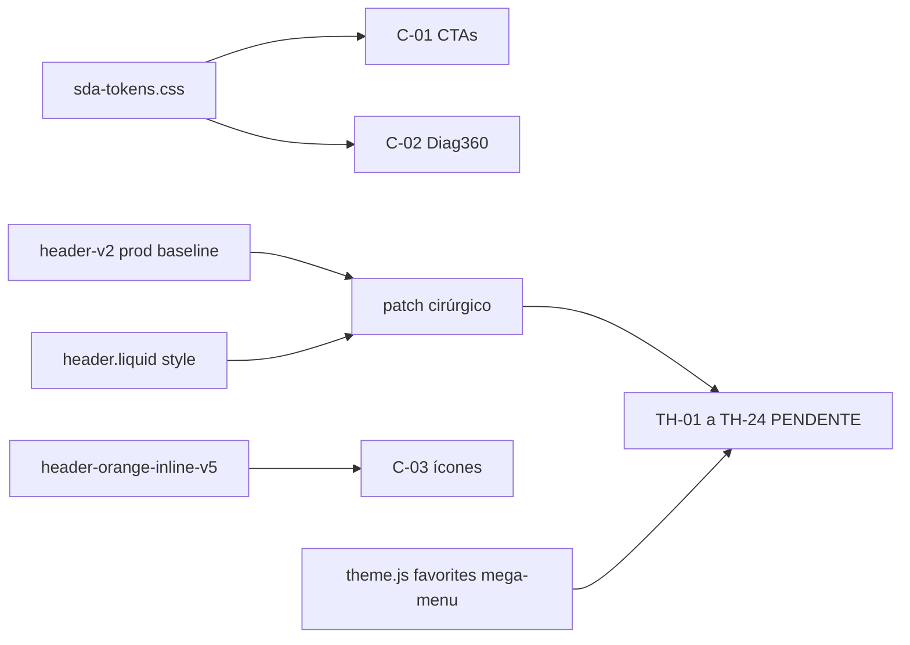

# Especificação — patch cirúrgico `header-v2.css` (tema 3)

**Status:** preparação documental — **sem arquivo pronto para upload**  
**Baseline obrigatório:** [`header-v2-producao-theme3-20261028.css`](../backups/header-v2-producao-theme3-20261028.css) (SHA `188a64cf…`)  
**Proibido nesta etapa:** substituir pelo monolito Git (`7af19626…`); remover `<style>` inline de `header.liquid`.

---

## 1. Zona intocável (copiar verbatim da prod)

| Seletores | Linhas ref. prod | Motivo |
|-----------|------------------|--------|
| `.mobile-catalog-dock__inner--quad` | ~1429 | Layout dock mobile |
| `.mobile-catalog-dock__inner--logged` | ~1433 | Conta logada no dock |
| `.mobile-catalog-dock__inner--logged .sda-dock-account-hidden` | ~1437 | Estado Alpine |
| `.mobile-catalog-dock__inner` | ~1441 | Container dock |
| `.mobile-catalog-dock__btn` | ~1446 | Botões dock |
| `.mobile-catalog-dock__icon svg` | ~1452 | Ícones |
| `body.has-mobile-catalog-dock` | ~1457 | Padding página |
| `body.has-mobile-catalog-dock .footer`, `footer.footer` | ~1461–1462 | **Footer mobile** — fora do header |

Qualquer diff deve **excluir** estas linhas (diff tool ou revisão humana).

---

## 2. Mudanças **desejadas** (candidatas — não implementadas)

Origem: delta prod vs Git revisão 2 + objetivos visuais Etapa Header; **cada item exige TH-* antes de considerar fechado**.

### C-01 — CTAs nav desktop (gradiente marca)

| Campo | Valor |
|-------|--------|
| **Seletor prod** | `.header-v2 .header-v2-cta-ambiente` (L453–470), `:hover` (472–475) |
| **Declaração prod (resumo)** | `background: var(--hdr-orange)` sólido; uppercase 13px |
| **Alteração proposta** | Gradiente laranja `linear-gradient(135deg, var(--sda-orange), var(--sda-orange-deep))` com `#fff` texto |
| **Motivo** | Alinhar à identidade SDA (tokens) |
| **Efeito visual esperado** | Botão “Compre por ambiente” mais saturado / gradiente |
| **Dependência A1** | **Sim** — tokens `--sda-orange*` devem existir em `:root` |
| **Conflito inline header** | **Sim** — `.header-v2-cta-ambiente--in-nav` no inline usa `#fff4e8` / `#9a4b05` (L585–587 backup header) e **pode vencer** por ordem/cascata |
| **Scripts WDNA** | Nenhum — links `<a href>` estáticos |
| **Colateral** | Variante `--in-nav` vs `.header-v2-cta-ambiente` genérico — testar TH-14 desktop **e** mobile catalog |
| **Comprovado?** | **Não** — paridade visual TH-14 **PENDENTE** |

### C-02 — CTA Diagnóstico 360 nav

| Campo | Valor |
|-------|--------|
| **Seletor prod** | `.header-v2 .header-v2-cta-diag360` (L484–520) |
| **Declaração prod (resumo)** | `display: none` no bloco base; estilo pill azul quando visível em breakpoints |
| **Alteração proposta** | `display: inline-flex` (≥992px) + gradiente roxo `--sda-purple*` (como intent Git L1536–1539) |
| **Motivo** | Destaque diag360 consistente com design system |
| **Efeito visual** | CTA roxo visível na barra nav desktop |
| **Dependência A1** | **Sim** |
| **Conflito inline** | Inline esconde/mostra nav row components — revisar `@media` inline L600, L634 |
| **Scripts** | Popup diag360 no `layout/theme.liquid` — **não alterar** JS |
| **Colateral** | Pode duplicar entrada diag no mobile (strip vs nav) |
| **Comprovado?** | **Não** |

### C-03 — Ícones ações desktop (pedidos, favoritos, carrinho)

| Campo | Valor |
|-------|--------|
| **Seletor prod** | `.header-v2 .header-v2-action__icon svg` (L301–304) |
| **Prod** | `width/height: 28px` |
| **Proposta** | `22px` + `!important` (Git L1520–1521) |
| **Motivo** | Harmonizar com emergency SVG rules no layout inline v5 |
| **Efeito** | Ícones ligeiramente menores |
| **Dependência A1** | Não |
| **Conflito layout `#header-orange-inline-v5`** | **Possível** — regras emergency 24px no layout; cascata entre layout inline vs header-v2 |
| **Conflito inline header** | `.sda-ico-stroke` 23px no inline (L579 backup) |
| **Scripts** | `openFavoritesPanel`, cart drawer — sem mudança |
| **Comprovado?** | **Não** — TH-09, TH-10, TH-15 |

### C-04 — Faixa utility altura

| Campo | Valor |
|-------|--------|
| **Seletor prod** | `.header-v2 .header-utility__inner` (L47–54); media queries L617, L1331 |
| **Proposta Git (ref.)** | `min-height: 32px; padding-top/bottom: 4px` |
| **Motivo** | Compactação vertical |
| **Efeito** | Utility bar mais baixa |
| **Conflito inline** | Inline define `min-height: 34px` utility inner (L557 backup) — **dupla fonte** |
| **Scripts** | Alpine `setupStore` / utility account — sem alteração |
| **Comprovado?** | **Não** — TH-11 |

### C-05 — Search pill mobile padding

| Campo | Valor |
|-------|--------|
| **Seletor prod** | `.header-v2 .header-v2-search-pill` (L906+, L1318) |
| **Prod** | `padding: 0 0 8px` (contexto mobile) |
| **Proposta** | `padding-top/bottom: 6px` (Git L1617–1619) |
| **Motivo** | Respiro vertical busca mobile |
| **Efeito** | Pill mais alta/baixa ~2px |
| **Scripts** | `alterForm2()`, `#term2` — **não tocar** |
| **Comprovado?** | **Não** — TH-03 |

---

## 3. Itens do monolito Git **excluídos** deste patch

| Item | Motivo exclusão |
|------|-----------------|
| `main.home-main, main.search-main, main.product-main` | Fundo página — fora escopo header |
| `.header-v2-mobile-strip*` completo | Prod usa catalog + inline; strip não comprovada no HTML ao vivo |
| `.sda-header-v2 .navbar-center` hide legacy | Pode esconder blocos WDNA account |
| Remoção `mobile-catalog-dock*` | **Proibido** |
| Regras `body .header:not(.header-checkout)` massivas | Alto risco cart/account/search legacy |

---

## 4. Dependências cruzadas (resumo)

| Camada | Interação |
|--------|-----------|
| Inline `header.liquid` | CTAs `--in-nav`, grid navbar, mobile catalog `display` — **sobrepõe** parcialmente header-v2 |
| Layout inline v5 | Badges carrinho, SVG size, hide compare JSON — manter até TH-17 |
| `mega-menu.css` | z-index nav — **não editar**; validar TH-05 |
| `theme.js` | Busca overlay, sidenav — TH-04, TH-08 |

---

## 5. Efeitos colaterais possíveis (não desejados)

| ID | Cenário | Detecção |
|----|---------|----------|
| X-01 | C-01/C-02 + inline → CTAs duplicados ou cores inconsistentes | TH-14 screenshot |
| X-02 | C-03 + layout v5 → ícones tamanhos mistos | TH-09–10 |
| X-04 | A1 + C-* → cards mudam junto com header | TA-02, TH-24 |
| X-05 | Dock/footer | TH-21–22 obrigatório após **qualquer** save header-v2 |

---

## 6. Entrega futura (fora desta tarefa)

1. Arquivo `header-v2-patched-YYYYMMDD.css` derivado da prod, diff ≤ C-01…C-05.  
2. Checklist “zona intocável” §1 passou.  
3. Upload painel + TH/TA — **PENDENTE**.
